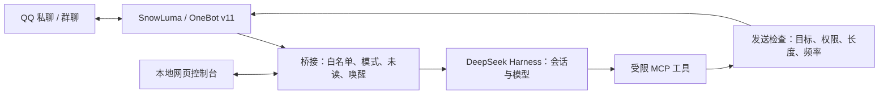

# QQ Chat Bot

把 QQ 私聊、群聊接入 DeepSeek Harness，让 AI 通过受限工具参与聊天。提供角色卡、仿真聊天、图片与表情、记忆与提醒、本地管理控制台，以及按需安装的 iPhone、Android、QQ 空间和 B 站适配。

桥接主体基于 [Derpyu520/qq-bridge](https://github.com/Derpyu520/qq-bridge) `v0.2.0-r4` 的改造版本；部署整合参考 [pinganbbOvO/ai-companion-kit](https://github.com/pinganbbOvO/ai-companion-kit)，可选 Android / QQ 空间服务也参考并改写其 `packages/phone-mcp`。本仓库保留来源声明，包含日记、知识库、风格学习、图片发送、语音转写和回复间隔控制等现有能力。个人配置和聊天数据由使用者在本机创建，详细来源见 [第三方说明](THIRD_PARTY_NOTICES.md)。

**第一次安装，从 [中文教程](docs/QUICKSTART.md) 开始。** 扩展能力按 [可选功能总教程](docs/OPTIONAL_FEATURES.md) 逐项配置；消息流转见 [功能与流程](docs/ARCHITECTURE.md)，分享代码或日志前看 [隐私说明](docs/guides/PRIVACY.md)。

## 能做什么

| 能力 | 说明 |
| --- | --- |
| QQ 接入 | 私聊、群聊白名单；每个 QQ 会话对应独立的 DSH 会话 |
| 仿真聊天 | 自主查看未读、等待、唤醒、潜水和发送；支持频率限制与连续气泡 |
| 人格管理 | 在控制台选择、编辑 Markdown 角色卡；二代唤醒按需注入，仓库附一份通用示例 |
| 会话设置 | 按会话覆盖模型和思考强度；策略 API 可读写配置，实际聊天模式与预设仍由全局设置决定 |
| 图片与表情 | 图片发送、表情收集、备注与记忆；图像理解取决于模型 |
| 长期信息 | 按会话保存记忆、日记与提醒；知识库、黑话与成员风格学习各有存储范围 |
| 可选语音 | 处理和发送已有音频；收到的语音可经本机 whisper.cpp 转写 |
| 搜索与学习 | 联网搜索、热榜、黑话与风格学习；可配置自动运行范围 |
| 可选外部能力 | iPhone 读取/控制、Android 读取/控制、QQ 空间读取/写入、B 站四项只读工具 |
| 可选空间管理与巡逻 | 读取动态、自己的说说与评论；按需发帖、精准回复和新评论提醒，受独立开关、演练、持久去重与配额限制 |
| 管理控制台 | 查看连接、会话、角色、工具开关、活动记录、token 用量和本地聊天指标 |
| 连接恢复 | 检查映射会话的归档状态，并处理 DSH 的 `blocked` 回合 |
| 权限控制 | 白名单、会话令牌、工具限制、出站检查与受限网络抓取 |

这些是程序能力，启用前仍需配置相应软件和模型。费用面板是按本地价格表计算的估算，不替代服务商账单。

iPhone 依赖另装 SideTap，B 站依赖另装 Python MCP 服务；Android 依赖 ADB 和设备授权；QQ 空间依赖 SnowLuma 提供对应接口。仓库提供适配代码与教程，不包含设备配对、平台登录资料或外部软件本体。

## 消息处理流程



二代仿真使用工具决定是否发言，模型返回的普通文本不会自动全部转发到 QQ。人格卡负责性格；预设负责工具和聊天协议。四种运行模式与能力边界见 [流程说明](docs/ARCHITECTURE.md)。

## 依赖与来源

| 软件 | 要求 / 官方入口 |
| --- | --- |
| Node.js | ≥ 22.13.0，包含 npm；[官方下载](https://nodejs.org/en/download) |
| DeepSeek Harness | 单独安装并配置模型；[上游项目](https://github.com/deepseek-ai/deepseek-harness) |
| SnowLuma | 单独安装、启动、登录 QQ 并配置 OneBot v11；[上游项目](https://github.com/SnowLuma/SnowLuma) |
| Git | 用于克隆和更新仓库；[官方下载](https://git-scm.com/downloads) |

这份源码沿用上游 DSH `0.2.0-rc.2` 适配基础。外部软件升级可能改变协议，不能把上游曾验证的版本视为任意新版的兼容保证。SnowLuma、DSH、本机音频工具、模型文件和登录数据均不打包。

## 快速开始

先按 [教程](docs/QUICKSTART.md) 安装并配置 DSH 与 SnowLuma，再执行：

```powershell
git clone https://github.com/han088693-debug/qq-chat-bot.git
cd qq-chat-bot
npm ci
Copy-Item -LiteralPath .\config.example.json -Destination .\config.json
```

编辑本机 `config.json`，填写实际 DSH/OneBot 地址。模板不含 QQ 号或令牌；白名单为空且 `allowAllWhenEmpty=false`，初次启动不会接入任何聊天对象。

完成 DSH 初始化后：

```powershell
node scripts/setup-dsh.mjs
```

按教程重启 DSH、启动 SnowLuma 并登录 QQ，然后在仓库运行：

```powershell
npm start
```

打开 [本地控制台](http://127.0.0.1:3100)，检查 QQ 在线、SnowLuma 已连接和 DSH 就绪，显式选择 `reserved2`，再加入自己决定开放的聊天对象。安装脚本使用 DSH profile 与插件 bundle；不要手工复制到旧的 `.agent-presets/` 目录。

已有 `config.json` 时不要重复复制覆盖。迁移仓库位置后需重新运行安装脚本。完整配置字段、启动顺序、角色选择和故障处理均在 [中文教程](docs/QUICKSTART.md)。

## 默认设置与可选功能

- 开发助手默认关闭；`closed-agent` 和管理员开发助手可拥有本地工具能力，需要自己明确配置。
- AI 发语音默认关闭，入站语音转写也默认关闭。转写需另外提供 FFmpeg、whisper.cpp 和模型，可用 `FFMPEG_PATH`、`WHISPER_CLI`、`WHISPER_MODEL` 指定路径。
- 回复最小间隔示例设为 120 秒；主动话题和黑话自动联网研究默认关闭。
- `optional/config.example.json` 中外部适配均关闭；设备控制、QQ 空间写入和截图落盘还有各自开关。
- QQ 空间扩展使用独立的 `qzonePatrol` 配置，模块、巡逻、评论守望者及各类写入均默认关闭，`dryRun=true`，允许名单为空；安装后不会自行开始扫描或互动。守望者需要另行指定允许接收提醒的私聊，并显式启动。
- 黑话基础学习、风格学习、热榜等已有能力有不同默认值；“可选功能”不代表全部默认关闭。实际字段和停用边界见下方教程。
- 新建的人格卡、音频、素材、运行数据和真实配置默认不入库。
- 上游独立 `voice-tool` 项目的 `voice-gui.mjs` / `voice-cli.mjs` 未随本仓库提供，本仓库保留桥接内的语音共享模块与控制台操作。

| 要配置的能力 | 教程 |
| --- | --- |
| 按会话模型、角色注入、日记隔离、插件与升级 | [会话功能与升级](docs/guides/SESSION_FEATURES.md) |
| 图片、形象、表情、音频与入站语音转写 | [媒体能力](docs/guides/OPTIONAL_MEDIA.md) |
| 轻量记忆、知识库、日记与提醒 | [记忆和长期信息](docs/guides/OPTIONAL_MEMORY.md) |
| 黑话、风格学习、联网搜索、热榜、主动话题与开发助手 | [学习和自动运行](docs/guides/OPTIONAL_AUTOMATION.md) |
| iPhone | [SideTap 接入](docs/guides/OPTIONAL_IPHONE.md) |
| Android | [ADB 接入](docs/guides/OPTIONAL_ANDROID.md) |
| QQ 空间兼容入口 | [phone 模块的读取和按需写入](docs/guides/OPTIONAL_QZONE.md) |
| QQ 空间管理与定时巡逻 | [9 个工具、精准回复、发帖、守望者与停用](docs/guides/OPTIONAL_QZONE_PATROL.md) |
| B 站 | [只读 MCP 接入](docs/guides/OPTIONAL_BILIBILI.md) |

外部适配的安装顺序是：先运行 `node scripts/setup-dsh.mjs` 同步当前聊天预设，再填写本机 `optional/config.json`，执行 `node optional/setup.mjs --check` 和 `node optional/setup.mjs`，最后重启 DSH。`--check` 只检查配置与安装计划，不连接设备或账号。完整步骤见 [总教程](docs/OPTIONAL_FEATURES.md)。

## 当前边界

按会话的模型和思考强度已接入主流程；策略中的 `mode` / `preset` 可以保存和校验，但尚未驱动逐会话模式及预设切换，也没有专用策略编辑页。Bridge 插件层已接入提醒、黑话和用量三个管理面，旧路由和原状态文件仍保留。可选适配没有替使用者完成手机配对、B 站登录或平台能力验证；`qq_phone_extend` 只保存延期状态，没有随仓库提供自动手机值班调度。自定义形象图片和个人表情素材需要自行提供，消息引用和媒体获取取决于网关提供的数据。

本次发布验证以干净安装、离线模拟和源码检查为范围；没有使用个人 QQ 账号进行真实收发测试。最新记录见 [发布与验证说明](docs/RELEASE_REVIEW.md)。

## 开发与验证

```powershell
node scripts/build-agent-preset-patches.mjs --check
npm run test:audit
node --test src/core/session-router.test.mjs src/core/session-policies.test.mjs
node scripts/test-plugin-host.mjs
node scripts/test-wake-role-card.mjs
node scripts/test-wake-role-inject.mjs
npm run test:memory-trends
npm run test:patrol
```

`test:audit` 使用模拟服务，强制关闭真实服务测试；缺少可选音频工具时可能有明确跳过项。`self-test`、真实服务诊断和发送脚本是另一类操作，可能调用模型或发送消息，运行前阅读脚本与教程。

现有 `privacy-scan` 是辅助规则扫描，存在误报豁免，不能单独证明没有隐私泄露。分享前应检查实际 Git 文件清单与新增内容，尤其是配置、预设、角色卡、测试样例、截图和日志。

## 文档与许可

- [安装、配置与排错教程](docs/QUICKSTART.md)
- [全部可选功能与安装入口](docs/OPTIONAL_FEATURES.md)
- [功能、模式与消息流程](docs/ARCHITECTURE.md)
- [会话功能、插件和升级步骤](docs/guides/SESSION_FEATURES.md)
- [目录地图](docs/FOLDER_MAP.md)
- [权限与运行规则](RULES.md)
- [隐私与上传范围](docs/guides/PRIVACY.md)
- [发布与验证说明](docs/RELEASE_REVIEW.md)
- [第三方组件说明](THIRD_PARTY_NOTICES.md)

桥接主体保留上游 [LICENSE](LICENSE) 中的 MIT 许可与版权声明。第三方软件适用各自条款，不能因为桥接代码使用 MIT，就推定其依赖和素材也可以任意再分发。
