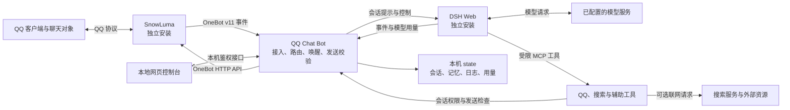

# 功能与流程说明

QQ Chat Bot 把 QQ 事件交给 DSH 中的 AI 会话，再将允许的回复送回 QQ。它包含桥接程序、网页控制台、受限聊天预设和工具适配层；QQ 协议接入由 SnowLuma 提供，模型推理由 DSH 配置的服务商提供。

安装步骤见 [安装与使用教程](QUICKSTART.md)。下面描述当前代码包含的能力，不表示每项能力在所有软件版本、模型或本机配置中都已经验证。

## 1. 系统组成

| 部分 | 负责什么 | 主要代码 |
| --- | --- | --- |
| 桥接主进程 | QQ 事件处理、会话管理、运行模式、消息闸门、控制台接口 | `src/bridge.js` |
| SnowLuma 连接 | OneBot 接入、重连、端点发现、上游状态 | `src/snowluma-conn.js` |
| DSH 客户端 | 本机鉴权、RPC、事件订阅、会话控制 | `src/dsh-client.js` |
| 网页控制台 | 状态、模式、角色、白名单、仿真设置、用量和诊断 | `public/console.html` |
| 聊天预设 | 角色注入之外的行为规则与工具约束 | `dsh/agent-presets/` |
| DSH 插件 | 注册预设及桥接设置 | `plugins/qq-agent-presets/`、`plugins/qq-mode-console/` |
| 工具适配 | 让 DSH 会话调用 QQ 工具、安全搜索和本机辅助能力 | `src/mcp-snowluma-safe.js`、`src/mcp-web-search-safe.js`、`src/mcp-host-server.js` |

三个服务是独立进程。桥接可以观察连接状态，但不会替你启动 SnowLuma 或完成 QQ 登录。

## 2. 一条消息如何往返

1. **接收事件。** SnowLuma 将 QQ 消息转成 OneBot 事件；桥接提取文本、引用、图片或语音等消息段。
2. **检查访问范围。** 桥接检查白名单、黑名单、当前模式和管理员身份。不在允许范围内的会话不会进入正常聊天流程。
3. **决定是否唤醒。** 二代仿真会结合私聊、提及、未读消息、等待状态、限频等条件决定是否让 AI 查看消息。不是每条群消息都会触发回复。
4. **准备上下文。** 桥接为私聊或群聊找到对应的 DSH 会话，组装角色、最近消息、未读内容和已启用的记忆等信息，再投递提示。
5. **调用模型和工具。** DSH 运行相应预设。二代仿真中，AI 可读取消息、等待、设置下一次唤醒，并通过 QQ 工具提出发送请求。
6. **检查并发送。** 桥接再次检查会话权限、模式、工具开关、长度、频率、重复内容及媒体限制，再调用 SnowLuma 发送。
7. **记录状态。** 更新未读游标、会话映射、活动记录和模型用量，供后续轮次及控制台使用。

在 `reserved2` 中，**普通模型输出不会自动变成 QQ 消息**；发送以工具调用为准。聊天内容、相关媒体和上下文可能随模型请求离开本机，因此加入白名单应当是有意识的选择。

## 3. 运行模式

| 模式 | 行为 | 适用范围 |
| --- | --- | --- |
| `chat` | 基础聊天和回复转发 | 调试或简单聊天 |
| `reserved` | 一代仿真，由桥接状态机控制参与节奏，使用文本分条和静默标记 | 保留旧协议 |
| `reserved2` | 二代仿真，通过工具阅读、发言、等待及设置唤醒 | 本教程采用的聊天模式 |
| `closed-agent` | 使用指定或 DSH 默认预设，允许更完整的工具面 | 仅管理员私聊 |

输入 `simulation` 会归一到内部的 `reserved2`。当前桥接的运行模式仍是**进程级设置**，不能把代码中独立的会话路由策略当成已经可用的逐会话模式切换。

模式由控制台写入 DSH 设置和本地备用文件。正常读取时优先使用 DSH 设置，无法取得时才尝试 `state/mode.json`；启动初值和已有状态也会影响结果。每次部署都应以控制台显示的当前模式为准。

## 4. 已实现的功能

| 功能 | 代码中的行为 | 使用条件或边界 |
| --- | --- | --- |
| 私聊与群聊接入 | 按 QQ 会话维护 DSH 会话映射 | 需要正确的 OneBot 配置及白名单 |
| 本地管理页面 | 连接状态、模式、角色、仿真参数、词库、用量、访问控制和运维入口 | 只监听本机回环地址；需要控制台令牌 |
| 二代自主聊天 | 未读消息、最近消息、等待、潜水、唤醒、连续气泡、发送限频 | 需要 `qq-chat-v2` 预设与相应工具开关 |
| 角色卡 | 从 Markdown 文件读取人格，并按一代/二代小节筛选 | 个人角色卡由使用者自行创建 |
| 引用与转发解析 | 提取消息关系和可取得的转发内容 | 取决于 SnowLuma 提供的消息字段及资源是否仍有效 |
| 图片与表情 | 图片下载、图片发送、表情库、备注、收集和记忆 | 图像理解依赖模型能力；本地文件受允许目录限制 |
| 语音发送 | 检查并发送已准备的音频，支持音量等处理 | 外部音频工具、音频素材和功能开关需另外准备 |
| 入站语音转写 | 网关转换音频后，经本地 whisper.cpp 转写并转简体 | 需要 FFmpeg、whisper.cpp、模型及相应配置；失败回退占位描述 |
| 记忆与知识库 | 保存、查询、整理记忆和知识条目 | 存在本机状态目录，不随仓库提供 |
| 日记与提醒 | 写读日记；创建、列出、取消及触发提醒 | 提醒触发依赖桥接运行及目标会话仍可用 |
| 黑话与风格学习 | 提取候选、查询、确认词条，构建风格提示 | 自动提取和研究可能产生模型调用；按需开启 |
| 联网搜索 | 安全搜索 MCP，对接已配置的搜索后端 | `auto` 路径可能回退到其他搜索服务；请求会离开本机 |
| 热榜与节日上下文 | 获取热榜缓存、提供节日信息供提示使用 | 热榜包含外部网络请求；缓存可能过期 |
| 用量与费用估算 | 接收 DSH 用量投影和事件，按会话、回合展示 | 金额依赖本地价格表；不是服务商账单 |
| 管理员开发助手 | 将管理员私聊中的配置前缀指令交给独立开发会话 | 可使用本地执行/文件工具；模板关闭，需另行配置 |
| 正在播放的音乐 | 读取 Windows 媒体会话信息 | 依赖 Windows 及播放器提供媒体会话 |

语音发送不等于内置完整的文字转语音服务；这里的基础能力是处理和发送已有音频。ASR 是将收到的语音转成文字，二者是不同功能。

## 5. 尚未完整接入的部分

| 部分 | 当前边界 |
| --- | --- |
| 逐会话模式、预设和模型策略 | `src/core/session-router.mjs` 有策略与测试，但主桥接未调用它；主流程仍使用全局模式 |
| 手机联动 | `qq_phone_extend` 只更新本机延期状态；完整手机控制和调度依赖仓库外的配套系统 |
| 其他外部工具 | 守卫兼容部分 B 站、手机、iPhone 和 QQ 空间工具名；对应服务不随仓库安装，实际能力取决于 DSH profile，部分工具可操作设备或对外发布 |
| 独立语音桌面工具 | 不包含外部 `voice-tool` 项目，也不提供其图形界面或命令行入口 |
| DSH 设置插件的专用界面 | 插件提供设置入口与协议装配；主要操作界面是桥接自带控制台 |
| 错误反馈主动通知管理员 | 当前相关错误通知路径只记录日志，不能当成已经发送 QQ 通知 |

这些边界来自当前源码接线情况，不应从函数名、测试文件或工作设想推断为完整可用功能。

## 6. 人格与预设的区别

**人格层**描述“AI 是谁、如何说话”，来自 `roles/*.md`。桥接在后续轮次读取和注入角色内容，因此更新角色卡通常不需要重启 DSH。

**预设层**描述“这个会话允许什么工具、如何使用聊天协议”，来自 `dsh/agent-presets/`。安装脚本将它生成到 `plugins/qq-agent-presets/` 的 patch，并通过 DSH profile bundle 装配。

修改预设后应重新运行安装脚本、重启 DSH并检查会话装配。不要直接改旧 `.agent-presets/` 目录，或只改已安装副本却不更新仓库源码。

## 7. 权限和数据位置

| 内容 | 保存或配置位置 | 是否适合提交仓库 |
| --- | --- | --- |
| 程序、网页、通用预设 | `src/`、`public/`、`dsh/`、`plugins/` | 可以，但修改后仍需审查 |
| 无真实账号的配置模板 | `config.example.json` | 可以 |
| 本机配置、QQ 号、令牌和路径 | `config.json` | 不提交 |
| 私密角色、关系描述及个人提示 | 本机角色文件和私有说明 | 不提交 |
| 会话映射、聊天日志、知识、日记、提醒、用量、媒体缓存 | `state/` 等运行目录 | 不提交 |
| DSH 凭据与会话记录 | 使用者自己的 `DSH_HOME` | 不提交 |
| SnowLuma 登录资料、QQ 数据与本地素材 | 各外部软件自己的目录 | 不提交 |

聊天预设限制本地执行和文件工具；桥接还会检查会话令牌和目标是否匹配。控制台令牌属于管理入口，不应放入角色卡或提供给聊天对象。管理员开发助手和 `closed-agent` 具有不同的能力范围，应单独配置。额外 MCP 的操作权限不等同于桥接白名单，具体见 [权限规则](../RULES.md)。

发送前的敏感内容检测只是代码中的一道检查，不能保证模型不会引用上下文中的私人信息。最直接的控制是：仅接入明确允许的聊天对象、只提供必要上下文，并在分享日志或截图前检查内容。

## 8. 验证边界

仓库提供本地样例测试、模拟服务测试，以及需要真实 DSH/模型的诊断脚本。**测试通过、服务启动、网关在线和 QQ 真实往返是四种不同结果。**

基础安装可先按 [教程的验证步骤](QUICKSTART.md#7-可选验证) 检查。真实模型测试可能消耗额度；发送类脚本、控制台测试消息、实际聊天及已启用的提醒可能向 QQ 发消息。公开说明不会把历史本机运行结果当成所有安装环境的保证。

遇到问题时，先判断它位于哪一段：QQ/SnowLuma 接收、桥接访问范围、DSH 鉴权与预设、模型返回、发送检查或网关发送。提交 Issue 时提供软件版本、错误类型和去掉账号及凭据后的最小复现，不上传整个运行目录。
